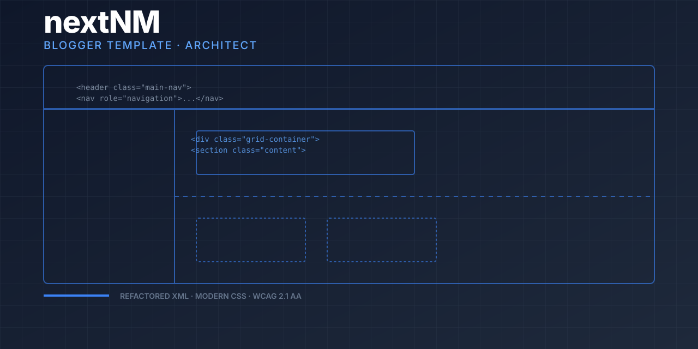

<div align="center">



# nextNM · Blogger Template

**Structure, refined.**  
A professionally restructured and CSS-upgraded Blogger XML template for developers who demand maintainable, performant themes.

[](https://nmstudioo.github.io/nextNM/)


[Overview](#overview) · [Features](#features) · [Design](#design-system) · [Structure](#repository-structure)

</div>

---

## Overview

The original Blogger template was flat, unorganized, and scattered. This repository rebuilds it with a logical HTML hierarchy, a comprehensive CSS variable system, and full WCAG 2.1 AA accessibility compliance.

> [!IMPORTANT]
> This is a developer-focused template. You should be comfortable editing XML and CSS before using it in production.

| Attribute | Value |
|:--|:--|
| **Format** | Blogger XML template |
| **CSS size** | ~45 KB (down from ~60 KB) |
| **Accessibility** | WCAG 2.1 AA |
| **License** | MIT |

---

## Features

- **Restructured HTML:** Logical organization with clear section comments and semantic hierarchy.
- **Modern CSS architecture:** CSS variables, Flexbox, Grid, mobile-first responsive design.
- **Accessibility first:** Full keyboard navigation, dark mode, high-contrast support.
- **Developer friendly:** Well-commented code and clear naming conventions.

---

## Design System — "Architect"

Deep blue with steel-grey neutrals. The design prioritizes readability and structural clarity.

| Role | Face |
|:--|:--|
| Display | **Inter Tight** |
| Body | **Inter** |
| Data | **JetBrains Mono** |

| Token | Value | Use |
|:--|:--|:--|
| `--bg` | `#0f172a` | Page background |
| `--blue` | `#3b82f6` | Accents, links |
| `--mut` | `#64748b` | Muted text |

---

## Repository Structure

```text
nextNM/
├── index.html          ← template preview
├── README.md
├── assets/
│   ├── cover.svg
│   └── style.css
├── docs/
│   ├── INSTALLATION.md
│   ├── USAGE.md
│   └── CSS-STRUCTURE.md
└── templates/
    └── blogger-template-restructured.xml
```

---

<div align="center">
<sub>Designed &amp; tuned by <b>Noushad M.</b> · © 2026</sub>
</div>
